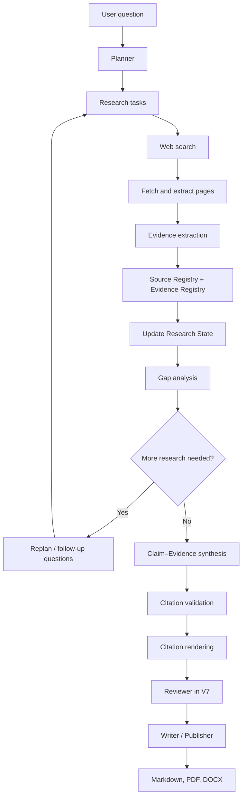
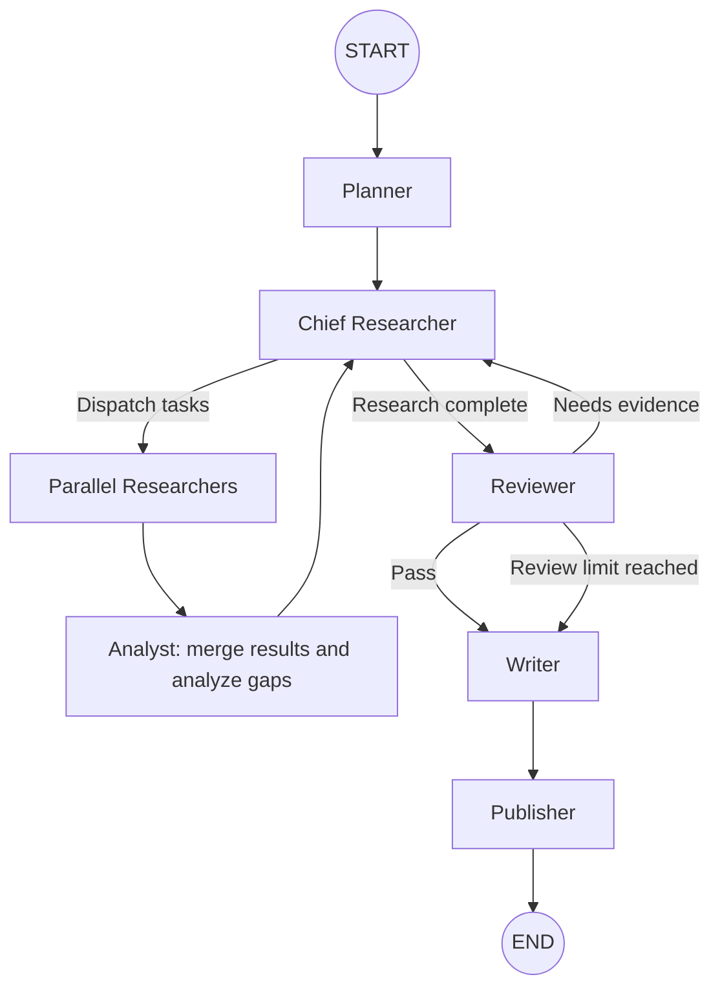

# BIGAndGreatest Researcher

**An iterative deep-research agent built from scratch, evolving from a simple search-and-answer pipeline to evidence-traceable research, LangGraph orchestration, and multi-agent review.**

BIGAndGreatest Researcher is a learning-oriented AI research-agent project. It explores how a research workflow can be built incrementally: first retrieve web information, then extract evidence, plan sub-questions, revisit research gaps, validate citation chains, and finally orchestrate the workflow with LangGraph and multiple agent roles.

> **Project status:** V1–V7 implementations are included in this repository snapshot. The V7 implementation is the main multi-agent entry point. External API credentials are required for live research. Features and dependencies described here are based on the source files in this repository snapshot; verify your local dependency/config files before running.

## Highlights

- **Incremental architecture:** seven versions make the evolution of the system inspectable rather than hiding everything behind a single framework.
- **Web research pipeline:** search, fetch/extract page content, filter low-quality results, and summarize source material.
- **Evidence extraction:** turn page content into smaller, traceable evidence items instead of relying only on search snippets or whole-page prompts.
- **Planning and iterative research:** break a question into sub-questions, analyze gaps and conflicts, and generate follow-up research tasks.
- **Citation traceability:** maintain source and evidence registries; map claims to evidence; validate citation chains; render references and traceability information in the report.
- **LangGraph workflow:** represent research steps, loops, routing, and stopping decisions as a `StateGraph`.
- **Multi-agent workflow (V7):** dispatch multiple Researcher tasks, merge their reports, review the research, and publish Markdown/PDF/DOCX outputs.

## Version roadmap

| Version | Main addition | What it changes |
|---|---|---|
| **V1** | Basic search-and-answer pipeline | Search for relevant pages, extract page content, and ask the LLM to answer the question. |
| **V2** | Evidence extraction | Extract structured evidence from page content before answer synthesis. |
| **V3** | Planner + synthesis | Split the original question into sub-questions, research each one, and synthesize the results. |
| **V4** | Research state + gap analysis + replanning | Track progress across rounds, identify missing or conflicting evidence, and schedule follow-up questions. |
| **V5** | Citation system | Add Source Registry, Evidence Registry, claim–evidence mapping, citation validation, and programmatic citation rendering. |
| **V6** | LangGraph orchestration | Express the research loop as a `StateGraph` while reusing V5's research and citation logic. |
| **V7** | Multi-agent collaboration | Add parallel Researcher dispatch, Analyst aggregation, Reviewer feedback loops, and report publishing. |

### Architecture at a glance



The diagram is a conceptual view of the overall evolution. V1–V5 use progressively richer single-file pipelines; V6 makes the research loop explicit in LangGraph; V7 adds parallel research tasks and review/publishing nodes.

## V7 workflow

V7 is the recommended entry point for exploring the latest version.



### V7 agent roles

- **Planner:** creates the initial research plan using the V5 planning logic.
- **Chief Researcher:** controls research progression and dispatches up to `MAX_PARALLEL_RESEARCHERS` tasks per wave.
- **Researcher:** researches an assigned sub-question using the existing V5 research pipeline.
- **Analyst:** aggregates parallel task results, updates shared research state, analyzes gaps, and replans.
- **Reviewer:** evaluates research completeness and reports issues; evidence-related issues can trigger another research cycle.
- **Writer:** synthesizes the final answer and runs the citation validation/rendering pipeline.
- **Publisher:** writes report artifacts to the output directory.

The workflow uses LangGraph `Command`, `Send`, state reducers, and `Overwrite` for task dispatch and result aggregation. Parallel task reports are merged before the Analyst updates the shared research state.

## Citation and evidence design

V5 introduces a traceability chain:

```text
Claim → Evidence → Source → Saved page content / URL
```

- **Source Registry:** assigns source IDs, canonicalizes URLs for deduplication, and stores page-content versions and hashes.
- **Evidence Registry:** assigns evidence IDs, associates evidence with a registered source, and checks extracted quotes against saved source content.
- **Claim–Evidence mapping:** synthesis produces structured claims and evidence references that can be checked by program logic.
- **Citation Validator:** checks IDs, URLs, quotes/content hashes, semantic support, and known conflicts; selected important claims can receive a second check.
- **Citation Renderer:** resolves internal evidence references to numbered citations, renders references and traceability information, and reports citation-quality issues.

These mechanisms improve traceability; they do **not** guarantee that every source is authoritative or that every generated claim is correct. Treat `unsupported`, `needs_review`, conflicts, and other quality indicators as meaningful limitations rather than silently assuming correctness.

## Repository structure

```text
Researcher/
├── README.md
├── research_v1.py
├── research_v2.py
├── research_v3.py
├── research_v4.py
├── research_v5.py
├── research_v6.py
└── research_v7/
    ├── __init__.py
    ├── __main__.py
    ├── main.py
    ├── graph.py
    └── agents.py
    └── state.py
```

- `research_v1.py`–`research_v5.py`: successive standalone versions.
- `research_v6.py`: LangGraph orchestration layer that imports and reuses V5 business logic.
- `research_v7/`: multi-agent graph, role nodes, state definition, and CLI entry point.
- The V7 CLI calls the V5 configuration loader and research functions, so `research_v5.py` must remain alongside the `research_v7/` package.

> Some development/test files and environment/dependency templates mentioned in earlier notes were not present in the ZIP snapshot used to prepare this README. Add or verify those files in the repository before documenting them as available.

## Requirements

- Python 3.10+ is a reasonable baseline for the syntax used in this codebase; use a recent Python version compatible with your installed LangGraph release.
- An LLM API endpoint and API key.
- A research/search API endpoint and API key. The configuration names suggest an OpenAI-compatible chat endpoint and a Tavily-style search endpoint, but the configured service must match the request/response formats implemented in the code.
- For V6/V7, LangGraph.
- For V7 PDF and Word exports, `reportlab` and `python-docx`.

The current ZIP snapshot does not include a `requirements-v6.txt`, `requirements-v7.txt`, or `.env.example`, although the existing README referred to them. Until you add and verify those files, install the packages explicitly and create `.env` manually.

## Setup

### 1. Create and activate a virtual environment

**Windows PowerShell**

```powershell
py -3 -m venv .venv
.\.venv\Scripts\Activate.ps1
python -m pip install --upgrade pip
```

**macOS / Linux**

```bash
python3 -m venv .venv
source .venv/bin/activate
python -m pip install --upgrade pip
```

### 2. Install V7 dependencies

```bash
python -m pip install langgraph reportlab python-docx
```

For V1–V5, the source files primarily use the Python standard library; V6 requires LangGraph. Dependencies can vary with the Python/LangGraph versions you choose.

### 3. Configure API credentials

Create a `.env` file in the project root, next to `research_v5.py`, using the following keys:

```dotenv
AI_BASE_URL=https://your-llm-provider.example/v1
AI_API_KEY=your-llm-api-key
AI_MODEL=your-model-name

RESEARCH_BASE_URL=https://your-search-provider.example
RESEARCH_API_KEY=your-search-api-key
```

Replace the example values with the actual endpoint, model name, and credentials for services compatible with the request formats implemented in the source code. Do not commit `.env` or real credentials to Git.

### 4. Run V7

From the directory containing `research_v5.py` and the `research_v7/` package:

```bash
python -m research_v7
```

Enter a research question at the `Q>` prompt. Enter `exit` or `quit` to leave the interactive loop.

V7 writes generated artifacts under a timestamped subdirectory of `output/`:

- `report.md` — Markdown report
- `report.pdf` — PDF report
- `report.docx` — Word document

The exact output depends on the run and on whether the external services return usable results.

### Run an earlier version

From the project root:

```bash
python research_v1.py
python research_v2.py
python research_v3.py
python research_v4.py
python research_v5.py
python research_v6.py
```

Use one command at a time. V6 needs LangGraph installed. For V1–V5, check each version's entry point and configuration requirements before running.

## Configuration reference

| Variable | Purpose |
|---|---|
| `AI_BASE_URL` | Base URL for the LLM API endpoint. |
| `AI_API_KEY` | API key for the LLM service. |
| `AI_MODEL` | Model identifier sent to the LLM service. |
| `RESEARCH_BASE_URL` | Base URL for the web-search API. |
| `RESEARCH_API_KEY` | API key for the web-search service. |

Research and report-generation limits—such as result count, extraction length, research rounds, parallel researcher count, and review-cycle count—are configured in the source files.

## Design decisions

1. **Build capability in layers.** Each version adds a specific capability so its purpose and trade-offs can be studied independently.
2. **Reuse the research core.** V6 and V7 import V5's research and citation functions rather than duplicating the entire business pipeline.
3. **Separate orchestration from domain logic.** LangGraph controls execution flow; the V5 module continues to own research, evidence, and citation operations.
4. **Keep traceability explicit.** Sources and evidence are registered before they are referenced in the final report.
5. **Bound iterative work.** Research rounds, parallel task batches, review cycles, and graph recursion are limited to reduce the risk of unbounded loops.

## Current limitations

- The workflow depends on external LLM and search services, so result quality, latency, cost, and availability vary by provider.
- Web extraction may fail on JavaScript-heavy pages, paywalled pages, anti-bot pages, or unusual encodings.
- Citation validation is a set of programmatic and model-assisted checks, not a formal proof of truth.
- The V6/V7 state contains in-memory Python objects and registries; durable checkpointing/resume is not implemented in the included design.
- V7's parallel Researcher execution does not mean every stage is parallel: aggregation, gap analysis, review, writing, and publishing still run in coordinated stages.
- This repository snapshot does not include automated test files, dependency lockfiles, or an `.env.example`; add/verify these before advertising a reproducible test workflow.

## Roadmap

- [ ] Add and verify `requirements-v6.txt` and `requirements-v7.txt`.
- [ ] Add a safe `.env.example` and ensure secrets/output/cache files are ignored by Git.
- [ ] Restore or include the automated test suite and document exact test commands/results.
- [ ] Add sample output with secrets removed and citations that can be checked manually.
- [ ] Add structured logging and run-level metrics for latency, token usage, search calls, and citation quality.
- [ ] Add checkpointing/serialization if pause-and-resume research is needed.
- [ ] Add evaluation cases for answer quality, evidence coverage, citation validity, and reviewer precision.

## Security

- Never commit API keys, `.env`, private research data, or generated reports containing sensitive information.
- Review source URLs and quoted text before relying on the report for high-stakes decisions.
- Respect website terms, access controls, and applicable copyright requirements when collecting web content.

## About

BIGAndGreatest Researcher is a hands-on project for understanding the engineering progression from a basic web-research pipeline to an iterative, evidence-traceable, LangGraph-orchestrated multi-agent research workflow.

